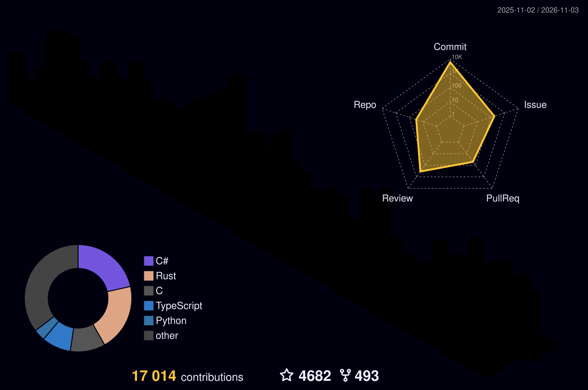

<div align="center">

  <!-- Animated Typing SVG -->
  <a href="https://github.com/Taiizor">
    
  </a>

  <br />

  <!-- Social Badges -->
  <p align="center">
    <a href="https://vegalya.com" target="_blank"></a>
    <a href="https://linkedin.com/in/Taiizor" target="_blank"></a>
    <a href="https://youtube.com/@iTaiizor" target="_blank"></a>
    <a href="https://x.com/iTaiizor" target="_blank"></a>
    <a href="https://reddit.com/user/iTaiizor" target="_blank"></a>
    <a href="https://tiktok.com/@itaiizor" target="_blank"></a>
    <a href="https://instagram.com/Taiizor" target="_blank"></a>
    <a href="mailto:taiizor@vegalya.com"></a>
  </p>

  <p align="center">
    
  </p>

</div>

---

### 👨‍💻 About Me

```csharp
public class Developer : Human
{
    public string Name => "Taiizor";
    public string Role => "Software Architect & Open Source Maintainer";
    public string[] CoreStack => [".NET", "Rust", "Tauri", "TypeScript", "Go"];
    public string[] FocusAreas => ["Desktop Architecture", "Cross-Platform Performance", "UI/UX Frameworks"];
    public string Mission => "Designing beautiful UI frameworks, fast tools, and reliable systems.";
}
```

---

### 🛠️ Tech Stack & Arsenal

<div align="center">

  #### ⚡ Core & Programming Languages
  <p align="center">
    <a href="https://skillicons.dev">
      
    </a>
  </p>

  #### 🖥️ .NET & Desktop UI Ecosystem
  <p align="center">
    <a href="https://skillicons.dev">
      
    </a>
    
    
    
    
    
  </p>

  #### 🌐 Web, Mobile & Runtime
  <p align="center">
    <a href="https://skillicons.dev">
      
    </a>
  </p>

  #### 🗄️ Databases, Caching & Queues
  <p align="center">
    <a href="https://skillicons.dev">
      
    </a>
  </p>

  #### 🧰 Tools, Engines & Platforms
  <p align="center">
    <a href="https://skillicons.dev">
      
    </a>
  </p>

</div>

---

### 🌟 Featured Open Source Projects

<table align="center" width="100%">
  <thead>
    <tr>
      <th align="left">Project</th>
      <th align="left">Description</th>
      <th align="center">Tech Stack</th>
      <th align="center">Stars</th>
    </tr>
  </thead>
  <tbody>
    <tr>
      <td><a href="https://github.com/Taiizor/ReaLTaiizor"><b>ReaLTaiizor</b></a></td>
      <td>Comprehensive, design-focused .NET WinForms control and theme library.</td>
      <td align="center"><code>C#</code> <code>.NET</code> <code>WinForms</code></td>
      <td align="center"><a href="https://github.com/Taiizor/ReaLTaiizor"></a></td>
    </tr>
    <tr>
      <td><a href="https://github.com/Taiizor/Sucrose"><b>Sucrose</b></a></td>
      <td>Versatile, interactive wallpaper engine designed to bring desktops to life.</td>
      <td align="center"><code>C#</code> <code>.NET</code> <code>Desktop</code></td>
      <td align="center"><a href="https://github.com/Taiizor/Sucrose"></a></td>
    </tr>
    <tr>
      <td><a href="https://github.com/Taiizor/Blazouter"><b>Blazouter</b></a></td>
      <td>Type-safe, React Router-inspired routing library for Blazor with nested routes.</td>
      <td align="center"><code>C#</code> <code>Blazor</code> <code>Wasm</code></td>
      <td align="center"><a href="https://github.com/Taiizor/Blazouter"></a></td>
    </tr>
    <tr>
      <td><a href="https://github.com/Taiizor/tauri-plugin-cache"><b>tauri-plugin-cache</b></a></td>
      <td>Cross-platform disk & memory caching plugin for Tauri apps with TTL & compression.</td>
      <td align="center"><code>Rust</code> <code>Tauri</code> <code>TypeScript</code></td>
      <td align="center"><a href="https://github.com/Taiizor/tauri-plugin-cache"></a></td>
    </tr>
    <tr>
      <td><a href="https://github.com/Taiizor/Zetian"><b>Zetian</b></a></td>
      <td>High-performance SMTP server library for .NET with TLS/SSL and authentication.</td>
      <td align="center"><code>C#</code> <code>.NET</code> <code>Networking</code></td>
      <td align="center"><a href="https://github.com/Taiizor/Zetian"></a></td>
    </tr>
    <tr>
      <td><a href="https://github.com/Taiizor/UUID"><b>UUID</b></a></td>
      <td>High-performance, thread-safe UUID library for the modern .NET ecosystem.</td>
      <td align="center"><code>C#</code> <code>.NET</code> <code>Security</code></td>
      <td align="center"><a href="https://github.com/Taiizor/UUID"></a></td>
    </tr>
  </tbody>
</table>

---

### 🧊 3D Contribution Calendar

<div align="center">
  <picture>
    <source media="(prefers-color-scheme: dark)" srcset="./profile-3d-contrib/profile-night-rainbow.svg" />
    <source media="(prefers-color-scheme: light)" srcset="./profile-3d-contrib/profile-green-animate.svg" />
    
  </picture>
</div>

---

### 📊 GitHub Activity & Statistics

<div align="center">
  <a href="https://github.com/Taiizor">
    
  </a>
  <br /><br />
  <a href="https://github.com/Taiizor">
    
  </a>
  <a href="https://github.com/Taiizor?tab=repositories">
    
  </a>
</div>

---

### 🏆 GitHub Trophies

<div align="center">
  <a href="https://github.com/Taiizor">
    
  </a>
</div>

---

### 🐍 Contribution Activity Snake

<div align="center">
  <picture>
    <source media="(prefers-color-scheme: dark)" srcset="./generated-stats/github-contribution-grid-snake-dark.svg" />
    <source media="(prefers-color-scheme: light)" srcset="./generated-stats/github-contribution-grid-snake.svg" />
    
  </picture>
</div>


